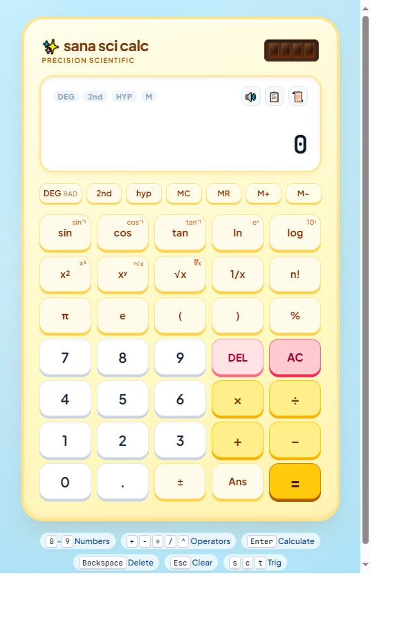

# ✨ sana sci calc

A scientific calculator web application featuring a soothing **baby blue** background, a warm **baby yellow** calculator body, responsive tactile buttons, synthesized acoustic keypress sounds, calculation history, and support for trigonometry, powers, roots, logs, and factorials.



---

## 🎨 Theme & Palette

- **Page Background**: Pastel Baby Blue (`#CBE8F8` / `#BAE6FD` / `#EBF8FF` radial gradient) with ambient glowing blur spheres.
- **Calculator Body**: Pastel Baby Yellow (`#FEF9C3` / `#FFF8C5` / `#FFF3B0` gradient) with soft amber beveling and golden trim (`#FDE68A`).
- **Display Screen**: High-contrast paper-white LCD screen (`#FFFFFF`) with sharp ink slate numerals (`#0F172A`) and mode indicator pills (`DEG`, `2nd`, `HYP`, `M`).
- **Tactile Keypad**:
  - **Numbers (0–9, .)**: Soft clean ivory with subtle 3D compression.
  - **Scientific Functions**: Butter yellow with shift/inverse notation indicators.
  - **Operators (+, −, ×, ÷)**: Warm pastel gold.
  - **DEL & AC**: Soft blush rose coral.
  - **Equals (=)**: Radiant golden sunbeam.

---

## 🚀 How to Run

No build step or server installation is needed!

1. Open this directory: `c:\Users\cccc\Downloads\antigravity sana calc`
2. Double-click **`index.html`** or right-click and choose **Open with > Google Chrome / Microsoft Edge / Firefox**.

---

## 🔬 Scientific Functions & Capabilities

### 1. Trigonometry & Hyperbolics
- `sin`, `cos`, `tan`
- Inverses via `2nd`: `sin⁻¹`, `cos⁻¹`, `tan⁻¹`
- Hyperbolic via `hyp`: `sinh`, `cosh`, `tanh`
- Inverse hyperbolic via `2nd` + `hyp`: `sinh⁻¹`, `cosh⁻¹`, `tanh⁻¹`
- **Angle Units**: One-tap toggle between **`DEG`** (Degrees) and **`RAD`** (Radians) with exact trigonometric snapping (e.g., $\sin(30^\circ) = 0.5$, $\cos(60^\circ) = 0.5$, $\tan(45^\circ) = 1$, $\sin(90^\circ) = 1$).

### 2. Powers, Roots & Exponentials
- $x^2$ (Square) and $x^3$ (Cube)
- $x^y$ (Power) and $^y\sqrt{x}$ (nth Root)
- $\sqrt{x}$ (Square Root) and $\sqrt[3]{x}$ (Cube Root)
- $e^x$ and $10^x$
- Natural log ($\ln$) and Base-10 log ($\log$)

### 3. Constants & Utilities
- $\pi$ ($3.14159265...$)
- $e$ ($2.71828182...$)
- Factorial $n!$ (e.g. $5! = 120$, with Gamma function extension for decimals)
- Reciprocal $1/x$
- Percentage $\%$
- Sign toggle $\pm$
- Last answer `Ans`

### 4. Memory Functions
- `MC`: Memory Clear
- `MR`: Memory Recall
- `M+`: Add current value to memory
- `M−`: Subtract current value from memory
- Status indicator `M` glows when a non-zero value is stored in memory.

### 5. Extra Productivity Features
- 📋 **One-Click Copy**: Copy result to clipboard with visual feedback tooltip.
- 🔊 **Acoustic Feedback**: Web Audio API synthesized soft clicks (toggleable on/off).
- 📜 **Calculation History**: Collapsible slide-up drawer preserving recent calculations with click-to-recall.
- 💾 **Local Persistence**: Calculation history, sound preferences, and memory values are remembered across sessions.

---

## ⌨️ Keyboard Shortcuts

| Key | Action |
| :--- | :--- |
| `0` – `9` | Digits |
| `.` | Decimal point |
| `+` | Addition |
| `-` | Subtraction |
| `*` or `x` | Multiplication ($\times$) |
| `/` | Division ($\div$) |
| `^` | Exponentiation ($x^y$) |
| `(` and `)` | Parentheses |
| `Enter` or `=` | Calculate result |
| `Backspace` | DEL (backspace last digit/character) |
| `Escape` | AC (All Clear) |
| `s` | $\sin$ / $\sin^{-1}$ |
| `c` | $\cos$ / $\cos^{-1}$ |
| `t` | $\tan$ / $\tan^{-1}$ |
| `l` | $\log$ |
| `n` | $\ln$ |
| `p` | $\pi$ |
| `e` | Euler's number $e$ |
| `!` | Factorial $n!$ |
| `%` | Percentage |

---

## 📂 Project Structure

```
antigravity sana calc/
├── index.html        # Main HTML5 application structure
├── style.css         # Styling (Baby Blue bg, Baby Yellow calculator, tactile buttons)
├── script.js         # Math evaluator, trigonometry engine, sound & state manager
├── preview.png       # Headless browser preview screenshot
└── README.md         # Documentation & guide
```
